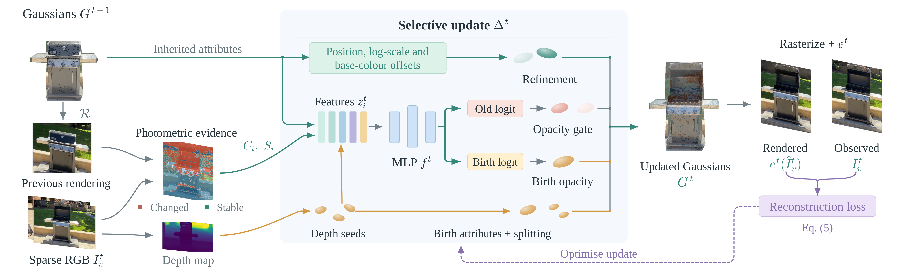

# ReScene: Incremental Scene Chronology from Sparse Revisits

ReScene incorporates sparse observations of a changing scene into a Gaussian reconstruction. It uses per-Gaussian change and stability evidence to guide suppression, refinement and new surface initialisation. Each visit is stored as an update so that earlier reconstructions remain recoverable.



This repository contains **ReScene code and instructions for reproducing our synthetic and real Multi-State experiments**. The [project-page source](https://github.com/waychin-weiqin/3DGSVer) is maintained separately. No baseline training pipelines, datasets or model checkpoints are included here.

## Installation

The reference environment is Linux, Python 3.10, PyTorch 2.5.1 and CUDA 12.4. Initial fitting, rasterisation and depth estimation require a compatible NVIDIA GPU and CUDA toolkit.

```bash
git clone https://github.com/waychin-weiqin/ReScene.git
cd ReScene
conda create -n chronogs python=3.10 pip -y
conda activate chronogs
export CUDA_HOME=/usr/local/cuda-12.4
bash examples/setup.sh
python -m pip install -e . --no-deps
python -m rescene check --runtime
```

The setup script fetches pinned dependencies and builds the visibility-safe renderer. MASt3R and LPIPS weights are obtained separately on first use; cache them before offline training. This is an editable source-checkout workflow, not a standalone wheel. See [third-party notices](LICENSES/README.md).

## Prepare the dataset

Obtain the supplied Multi-State releases separately. This repository does not assert a public download URL. Preserve the original train/test splits and camera files.

| Subset | Scenes | Input support |
|---|---|---|
| Synthetic | Robot, Teddy, Plant, Cloth | Exact synthetic cameras; initial training-depth point cloud |
| Real | Can, Tissue, Tomato, Gimbal | Real SfM points; frozen accepted background alignment |

Synthetic data retain the internal directory name `multistate_hard`. Real data use the original `wei_real_multistate_20261030` release. The real adapter verifies calibration-file hashes before applying the included transforms. Do not pass an already transformed dataset. Shirt and Hulkbuster are excluded.

## Quick start

Run the route for your dataset:

```bash
# Synthetic Multi-State
python examples/synthetic.py prepare --dataset-root /path/to/multistate_hard --gpus 0
python examples/synthetic.py smoke --gpus 0
python examples/synthetic.py run --gpus 0

# Real Multi-State
python examples/real.py prepare --dataset-root /path/to/wei_real_multistate_20261030 --gpus 0
python examples/real.py smoke --gpus 0
python examples/real.py run --gpus 0
```

Preparation does not train. The smoke route includes full initial fitting and short update tests, so it is not a quick CPU test. The full run reuses validated stages and evaluates every observed visit. Preserve at least 104 GiB of free disk space for real runs and 100 GiB for synthetic runs. Use the same `--scenes` and GPU selection throughout a frozen run.

Detailed data layouts, settings and output paths are in the [synthetic guide](examples/synthetic.md) and [real guide](examples/real.md).

## Evaluation and retrieval

```bash
python eval/multistate.py --subset synthetic
python eval/multistate.py --subset real
```

These commands validate and summarise the renders produced by the runner. Reports contain PSNR, SSIM, LPIPS, history storage and per-visit results. See [evaluation details](eval/README.md) and [rendering a stored visit](demo/README.md). Reference ReScene metrics and validation records are in `reproduction/`.

## Protocol and validation

The benchmark configuration uses up to 24 current images and 5,000 steps per update, with a 60,000-birth ceiling. It retains the **original objective, including regularisers**, used for the reported benchmark runs. Experimental ablations and later manuscript simplifications are not substituted for that configuration.

Synthetic initialisation uses oracle depth from initial training views. Real SfM includes held-out images, and offline alignment uses training images across visits. Real scenes have arbitrary scale and no ground-truth geometry. These are reproduction limitations, not image-only or causal registration claims.

The repository separation changes paths and packaging, not the training equations. Validation scope is recorded in `reproduction/layout-validation.json`; preparation/import checks are distinguished from a fresh end-to-end training reproduction.

## Repository structure

```text
rescene/        Core model, renderer adapter and preparation/training pipeline
examples/       Setup and synthetic/real reproduction workflows
eval/          Evaluation entry point and metric documentation
demo/          Stored-visit rendering utility
assets/         Method illustration for this README
configs/        Frozen benchmark configuration
reproduction/   Dependency pins, accepted alignments and reference metrics
patches/        Required upstream integration patches
LICENSES/       Third-party notices
pyproject.toml  Editable Python package and command-line entry point
```

Only the folder organisation is inspired by SOLV3R; no SOLV3R implementation or licence is copied. A licence for ReScene-authored code has not been selected in this release preparation. Third-party components retain their own terms, including research/non-commercial restrictions where applicable. Do not infer an Apache-2.0 licence from the reference repository.
